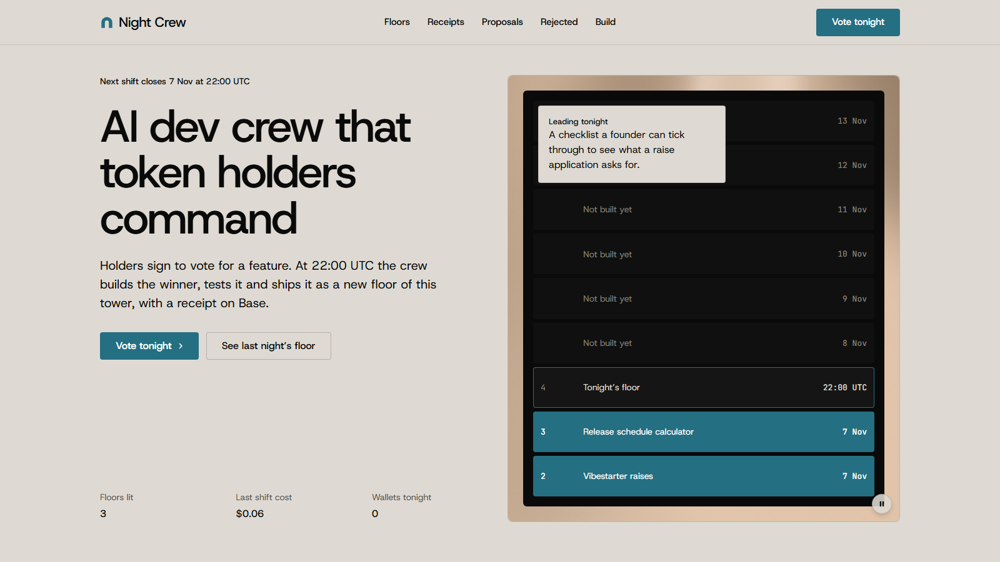

<!-- readme-schema: R5-agent-ai v1 -->
# Night Crew

An AI dev crew that token holders command: sign to vote for a feature, and by morning it ships as a new floor, with a receipt on Base.

## Demo

Live app: https://nightcrew-gray.vercel.app



## What it does

Token communities outlive the people who built for them. Holders have opinions but no way to turn them into shipped product, because governance votes end in a forum post. Night Crew changes that: any wallet proposes a feature in one sentence, and holders vote by signing a gasless message, weighted by their $VIBES. At 22:00 UTC an AI crew takes the top proposal that passes safety triage, builds it as one small working tool, tests it and ships it as a new floor of a public tower, with no human touching the code. Every shift publishes a receipt, passed or failed, with the transcript, the diff, the tests, the cost and an attestation on Base.

## Quickstart

```
npm install
node scripts/copy-taste.mjs
npm run dev
```

Open http://127.0.0.1:3000. With no `DATABASE_URL` set, the app runs on an in-process Postgres with fixture data, so every page works locally.

## Built at Vibeathon 02: Night shift

Built during Vibeathon 02 (Vibestarter), 2 to 9 November 2026. There are no tracks: this entry aims at the published rubric. Solo builder plus AI. Everything here was built during the event from a written spec, with Claude Code agents working one tested task at a time. Claude agents also run the product's own nightly shifts.

Night Crew is an independent project, not affiliated with Vibestarter.

## How the agent works

A shift is four GitHub Actions jobs, each holding only what it needs.

1. **Close** reads the votes, fixes the snapshot block from the 22:00 UTC clock, and ranks the proposals.
2. **Crew** runs three agents. Triage (Claude Haiku 5.5, no tools) takes the top proposal that passes and rewrites it as a build brief. Build (Claude Sonnet 5.5, reached through OpenRouter) runs in a small tool loop: it writes the floor and checks it against the static rules, without ever running it. Review (Claude Haiku 5.5, no tools) reads the result and can send it back once.
3. **Verify** runs on a fresh machine with no secrets, and tests the floor in real Chrome with a fake wallet.
4. **Publish** stores the floor and its receipt, then attests the receipt on Base through EAS.

## Prompts & safety

The rule is that the agent has no authority. Proposals are hostile public text, so the build agent gets exactly three tools: write one of two named files in a temp folder, read a file in that folder, and run the static check. It has no shell, no network and no way to read the key its own job holds, with hard limits on turns, tokens, spend and time. Nothing in that job runs what it writes: the browser test happens later, in a job with no secrets. The worst it can do is write bad files, and the gate rejects those.

Floors are AI-written code running next to a visitor's wallet. Each floor is served with hash-pinned scripts under a sandbox CSP, on an opaque origin, with no network, no storage and no wallet access. A guard runs first, and the floor's script is wrapped so `window` and wallet globals are shadowed. A set of hostile floors in `tests/` proves this holds with the static checks switched off.

The prompts are in `crew/prompts/`. Triage rejects offensive, illegal or impersonating content, investment claims, and anything a floor cannot do. The builder can veto too. Every rejection is published with its reason at `/rejected`.

No browser-side guard can cover every wallet extension. A deliberately hidden escape that beat every layer would still only raise a prompt the visitor must approve.

## Run it

```
npm test
npm run build && npm start
```

Tests need Chrome. Set `CHROME_PATH` if it is not at the usual path.

| Variable | Where | Purpose |
|---|---|---|
| `DATABASE_URL` | GitHub, Vercel | Neon Postgres. Unset locally, which uses in-process PGlite. |
| `OPENROUTER_API_KEY` | GitHub | The crew job only. Set a credit limit on the key. |
| `ATTESTER_PRIVATE_KEY` | GitHub | The publish job only. Signs attestations. |
| `BASE_RPC_URL` | GitHub, Vercel | Optional. Defaults to the public Base RPC. |
| `CREW_BUILD_MODEL`, `CREW_SHIFT_CAP_CENTS`, `CREW_TOTAL_BUDGET_CENTS` | GitHub | The model and spend limits. |
| `CREW_STRUCTURED_MODE`, `CREW_BUILD_TRANSPORT` | GitHub | Optional fallbacks that `crew/probe-openrouter.ts` may ask for. |
| `EAS_SCHEMA_UID` | GitHub | From `crew/register-schema.ts`. |
| `SHIFTS_ARMED` | GitHub | Set to `true` to turn on the nightly schedule. |
| `VETO_ADDRESS` | GitHub, Vercel | The builder's wallet. Public. |
| `NEXT_PUBLIC_SITE_ORIGIN` | Vercel | The main URL. |
| `FLOORS_ORIGIN` | Vercel | Optional second hostname for floors. |
| `RATE_LIMIT_SALT` | Vercel | Salts the hashed IP used for rate limits. |

## Tech stack

Next.js 16, React 19, TypeScript, Postgres (Neon), viem and wagmi on Base, EAS for attestations, Claude through OpenRouter, Playwright with Chrome for the floor gate, and GitHub Actions for the nightly run.

## Roadmap

- Known limit: the staking API has no history, so stake is read at tally rather than at the snapshot block.
- Known limit: weight is linear, so a large holder can decide a night alone. The tally shows weight and wallet count side by side.
- Next: a second community, from the waitlist on `/built`.

## License

Copyright 2026 the Night Crew builder. All rights reserved until a license is chosen.
